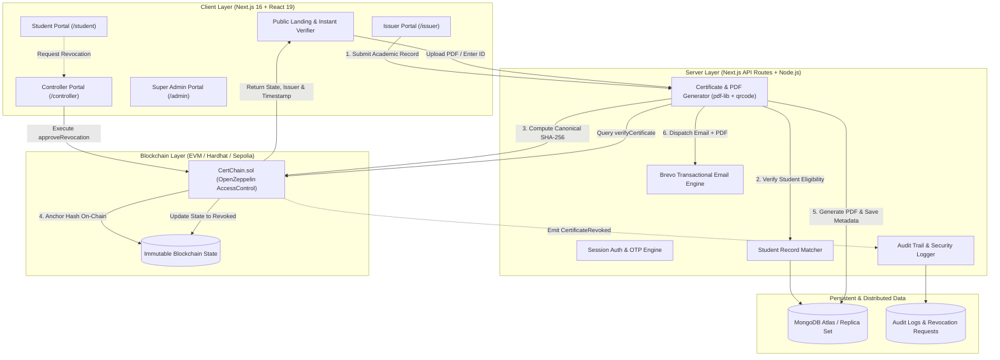

# 🎓 PUB CertChain — Blockchain-Based Academic Certificate Verification System

[](https://nextjs.org/)
[](https://react.dev/)
[](https://soliditylang.org/)
[](https://hardhat.org/)
[](https://www.openzeppelin.com/contracts)
[](https://www.mongodb.com/)
[](https://docs.ethers.org/)
[](https://tailwindcss.com/)
[](https://opensource.org/licenses/MIT)

> **An enterprise-grade, decentralized credential management and instant public verification platform developed for Pundra University of Science & Technology (PUST / PUB).**

---

## 📌 Executive Summary

Academic credential fraud, forged degree certificates, and slow, manual background verification processes cost universities and employers millions annually. **PUB CertChain** solves this crisis by combining **Ethereum smart contracts**, **SHA-256 cryptographic hashing**, **dynamic QR code generation**, and a **multi-tier Role-Based Access Control (RBAC)** architecture.

Every degree certificate issued by the University is mathematically fingerprinted, registered permanently on an immutable blockchain ledger, embedded into a high-security PDF, and delivered to students with automated email notifications. Employers, academic institutions, and embassies can verify any certificate in milliseconds without paying gas fees or requiring specialized Web3 wallets.

---

## 🌟 Key Features & Capabilities

### 🛡️ 1. Cryptographic Tamper-Proof Anchoring
- **Zero-Trust Integrity**: Every certificate PDF's canonical content is hashed using SHA-256. The hash is permanently written to the smart contract along with the unique Certificate ID and issuer timestamp.
- **Active Tamper Detection**: If even a single character, date, or GPA decimal point is altered (e.g., modifying CGPA `3.20` to `3.95`), the client-side calculated hash mismatches the ledger hash. The platform immediately flags the document as **`INVALID_MODIFIED`** and logs a security alert.

### ⚡ 2. Instant Zero-Gas Public Verification
- **Multi-Modal Verification**: Verifiers can authenticate certificates via:
  1. **Direct Certificate ID lookup** (e.g., `PUB-DEG-2026-000105`).
  2. **PDF File Upload** (browser calculates SHA-256 fingerprint client-side without exposing student data unnecessarily).
  3. **QR Code Scanning** (mobile camera / webcam scanning with instant lookup).
- **Zero Gas Cost for Verifiers**: Uses EVM `view` calls (`verifyCertificate` and `verifyCertificateByHash`) for instantaneous, free verification worldwide.

### 👥 3. Multi-Tier Role-Based Access Control (RBAC)
- **Super Administrator (`DEFAULT_ADMIN_ROLE`)**:
  - Manages university officials, system parameters, and smart contract role authorizations.
  - Grants/revokes `ISSUER_ROLE` and `CONTROLLER_ROLE` on-chain.
  - Monitors system-wide audit logs, user activity, and blockchain health.
- **Controller of Examinations (`CONTROLLER_ROLE`)**:
  - Executive authority over credential validity.
  - Reviews and acts upon formal revocation requests.
  - Executes on-chain revocations with documented justification (`approveRevocation`).
- **Authorized Certificate Issuer (`ISSUER_ROLE`)**:
  - Pre-validates student academic data against verified records (`StudentRecordMatcher`).
  - Issues single or bulk/batch certificates with optimized gas consumption.
  - Generates tamper-proof PDFs with embedded QR codes.
  - Triggers automated student email delivery via Brevo.
- **Student Portal**:
  - Authenticated access to issued academic certificates.
  - High-resolution PDF downloads with cryptographic QR stamps.
  - Creation of **time-expiring, privacy-preserving share links** (`/s/[token]`) for job applications.
  - Formal submission of correction/revocation requests.

### 📧 4. Automated Communications & Notifications
- **Brevo (Sendinblue) REST API v3 Integration**: Automatically sends congratulatory emails with credentials, PDF attachments, and direct verification links upon issuance.
- **OTP Verification**: Secure email-based OTP verification for sensitive operations and account onboarding.

### 📊 5. Comprehensive Audit Trail & Compliance
- Every administrative action, issuance, download, public verification attempt, and tamper detection event is logged to MongoDB with timestamp, IP address, user agent, and actor role.

---

## 🏛️ System Architecture



---

## 📜 Smart Contract Specification (`CertChain.sol`)

The smart contract is written in Solidity `^0.8.20` and inherits OpenZeppelin's `AccessControl` for enterprise role governance:

```solidity
struct CertificateRecord {
    string certId;             // Unique Identifier (e.g., PUB-DEG-2026-000105)
    bytes32 sha256Hash;        // Canonical SHA-256 cryptographic digest
    address issuer;            // Authorized issuer wallet address
    uint256 issuedAt;          // Unix timestamp of issuance
    bool isRevoked;            // Revocation state flag
    string revocationReason;   // Documented rationale if revoked
    uint256 revokedAt;         // Unix timestamp of revocation
    address revokedBy;         // Controller wallet address who revoked
}
```

### Key Contract Methods

| Function Signature | Access Role | Gas Type | Description |
| :--- | :--- | :--- | :--- |
| `issueCertificate(string, bytes32)` | `ISSUER_ROLE` | State-Changing | Anchors a single certificate record on-chain. |
| `batchIssueCertificates(string[], bytes32[])` | `ISSUER_ROLE` | State-Changing | Gas-optimized bulk issuance for graduating cohorts. |
| `approveRevocation(string, string)` | `CONTROLLER_ROLE` | State-Changing | Marks certificate revoked with audited justification. |
| `verifyCertificate(string)` | `Public` | **Read-Only (Zero Gas)** | Retrieves complete status, issuer, and timestamps by ID. |
| `verifyCertificateByHash(bytes32)` | `Public` | **Read-Only (Zero Gas)** | Reverse-lookup verification by SHA-256 hash. |
| `addIssuer(address)` / `removeIssuer(address)` | `ADMIN` / `CONTROLLER` | State-Changing | Authorizes or de-authorizes an issuer wallet. |
| `addController(address)` | `DEFAULT_ADMIN_ROLE` | State-Changing | Appoints a new Controller of Examinations. |
| `getTotalCertificates()` | `Public` | **Read-Only (Zero Gas)** | Returns total number of certificates registered on-chain. |

---

## 💻 Tech Stack Matrix

| Domain | Technology / Library | Version | Purpose |
| :--- | :--- | :--- | :--- |
| **Frontend Framework** | [Next.js (App Router)](https://nextjs.org/) | `16.4.2` | Server & Client Components, Dynamic Routes, Turbopack |
| **UI Library** | [React](https://react.dev/) | `19.3.0` | Declarative UI, Concurrent rendering |
| **Styling** | [Tailwind CSS](https://tailwindcss.com/) | `v4.0` | Modern responsive styling, glassmorphism, UI tokens |
| **Icons** | [Lucide React](https://lucide.dev/) | `1.59.0` | Modern, clean vector iconography |
| **Smart Contracts** | [Solidity](https://soliditylang.org/) | `^0.8.20` | Core registry logic & on-chain state machine |
| **Contract Security** | [OpenZeppelin Contracts](https://www.openzeppelin.com/) | `v5.6.1` | Battle-tested `AccessControl` implementation |
| **Development Network**| [Hardhat](https://hardhat.org/) | `^2.29.1` | Local EVM blockchain, compilation, unit testing, scripting |
| **Web3 Client** | [Ethers.js](https://docs.ethers.org/) | `^6.17.0` | EVM contract interaction, wallet signing, byte parsing |
| **Database** | [MongoDB](https://www.mongodb.com/) / [Mongoose](https://mongoosejs.com/) | `^9.11.2` | High-availability document store for metadata & logs |
| **PDF Generation** | [pdf-lib](https://pdf-lib.js.org/) | `^1.17.1` | Low-level vector PDF synthesis & dynamic stamps |
| **QR Engine** | [qrcode](https://www.npmjs.com/package/qrcode) & [jsqr](https://github.com/cozmo/jsQR) | `1.5.4` / `1.4.0` | QR generation & camera-based decode scanner |
| **Email Service** | [Brevo Transactional API](https://www.brevo.com/) | `v3` | Automated transactional email notifications with attachments |
| **Security & Auth** | [bcryptjs](https://www.npmjs.com/package/bcryptjs) | `^3.0.3` | Cryptographic password hashing & salted sessions |

---

## 📁 Repository Structure

```text
certchain/
├── contracts/
│   └── CertChain.sol              # Solidity smart contract (AccessControl, issuance, revocation)
├── scripts/
│   ├── deploy.js                  # Automated contract deployment & ABI/address export script
│   ├── create-super-admin.mjs     # Database seeder for Super Admin credentials
│   ├── test-tamper-detection.mjs  # CLI test suite validating SHA-256 tamper rejection
│   ├── set-controller-password.mjs# Convenience script for controller account setup
│   └── export-demo-files.mjs      # Exporter for demo certificates into /demo
├── demo/
│   ├── PUB-DEG-2026-000105.pdf    # Authentic certificate for demo testing
│   ├── PUB-DEG-2026-000105-tampered.pdf # Altered copy (tamper detection test)
│   ├── CERT-DEMO-2026-002-revoked.pdf   # Officially revoked certificate sample
│   └── README.md                  # Step-by-step evaluator testing guide
├── test/
│   └── CertChain.test.js          # Hardhat unit tests for smart contract methods & events
├── public/                        # Static assets, university logos, watermarks
├── src/
│   ├── app/
│   │   ├── page.tsx               # High-converting public landing page & instant verifier
│   │   ├── layout.tsx             # Root layout with font optimization & global providers
│   │   ├── login/                 # Unified role-based authentication portal
│   │   ├── register/              # Self-service student registration with record matching
│   │   ├── verify/                # Dedicated public verification page (ID / Hash / QR)
│   │   ├── s/[token]/             # Public resolver for time-expiring student share links
│   │   ├── dashboard/             # Role-specific dashboard gateways
│   │   ├── admin/                 # Super Admin control center
│   │   ├── controller/            # Controller of Examinations review & revocation portal
│   │   ├── student/               # Student certificate management & share link generator
│   │   └── api/                   # REST API backend routes
│   │       ├── auth/              # Login, register, logout, OTP handlers
│   │       ├── certificates/      # Issuance, PDF generation, bulk CSV upload
│   │       ├── public/verify/     # Zero-gas verification query endpoint
│   │       ├── controller/        # Revocation approval/rejection endpoints
│   │       └── admin/             # Role delegation & audit log access
│   ├── components/                # Modular UI component library
│   │   ├── public/                # Landing hero, verification modal, features, FAQs
│   │   ├── student/               # Certificate viewer, share modal, request forms
│   │   ├── issuer/                # Single/batch issuance forms, student record lookups
│   │   ├── controller/            # Pending revocation review table, modal dialogues
│   │   ├── admin/                 # User management, role assigner, system metrics
│   │   └── layout/                # Global navigation header, user dropdown, footer
│   ├── lib/
│   │   ├── mongodb.ts             # Cached Mongoose database connection client
│   │   ├── authSession.ts         # Ironclad cookie session parsing & role enforcement
│   │   ├── brevo.ts               # Brevo API client for transactional templates
│   │   ├── studentRecordMatcher.ts# Fuzzy & exact academic record validation engine
│   │   ├── pdf/
│   │   │   └── certificateGenerator.ts # PDF vector template synthesizer with QR code
│   │   └── web3/
│   │       ├── serverWeb3.ts      # Server-side ethers.js contract signer & provider
│   │       ├── certChainClient.ts # Client-side web3 utilities for read queries
│   │       ├── CertChainABI.json  # Auto-synced contract ABI
│   │       └── contractDeployment.json # Auto-synced contract address & chain parameters
│   └── models/                    # Mongoose schemas
│       ├── User.ts                # Administrative & student credentials, roles, statuses
│       ├── Certificate.ts         # Certificate metadata, IPFS/local URI, SHA-256 hash
│       ├── StudentRecord.ts       # Pre-seeded official academic records (ground truth)
│       ├── RevocationRequest.ts   # Formal revocation request queue & decision logs
│       ├── AuditLog.ts            # Immutable security & verification event logs
│       ├── ShareLink.ts           # Tokenized, expiring public share permissions
│       └── OtpVerification.ts     # Email OTP authentication challenges
├── hardhat.config.js              # Hardhat EVM network configuration & compilers
├── package.json                   # Project dependencies and deployment scripts
└── tsconfig.json                  # Strict TypeScript configuration
```

---

## 🚀 Quickstart & Local Installation Guide

### Prerequisites
- **Node.js**: `v20.x` or higher installed ([Download Node.js](https://nodejs.org/))
- **MongoDB**: Local MongoDB daemon running (`mongodb://127.0.0.1:27017`) OR a free [MongoDB Atlas](https://www.mongodb.com/atlas) cluster URI.
- **Git**: Installed on your operating system.

---

### Step 1: Clone Repository & Install Dependencies

```bash
git clone https://github.com/Md-Shakib-Akando/CertChain.git
cd certchain
npm install
```

---

### Step 2: Environment Configuration

Create a `.env.local` file in the root directory (you can copy `.env.example`):

```bash
cp .env.example .env.local
```

Ensure the following environment variables are properly defined:

```env
# ------------------------------------------------------------------------------
# 1. Application Environment
# ------------------------------------------------------------------------------
NODE_ENV=development
PORT=3000
NEXT_PUBLIC_APP_URL=http://localhost:3000

# ------------------------------------------------------------------------------
# 2. Database Configuration
# ------------------------------------------------------------------------------
# Local MongoDB:
MONGODB_URI=mongodb://127.0.0.1:27017/certchain
# Or MongoDB Atlas:
# MONGODB_URI=mongodb+srv://<user>:<password>@cluster0.mongodb.net/certchain?retryWrites=true&w=majority

# ------------------------------------------------------------------------------
# 3. Blockchain & Smart Contract
# ------------------------------------------------------------------------------
CHAIN_RPC_URL=http://127.0.0.1:8545
CONTRACT_ADDRESS=0x5FbDB2315678afecb367f032d93F642f64180aa3

# Hardhat Account #0 (Super Admin):
ADMIN_PRIVATE_KEY=0xac0974bec39a17e36ba4a6b4d238ff944bacb478cbed5efcae784d7bf4f2ff80

# Hardhat Account #1 (Controller of Examinations):
CONTROLLER_PRIVATE_KEY=0x59c6995e998f97a5a0044966f0945389dc9e86dae88c7a8412f4603b6b78690d

# Hardhat Account #2 (Authorized Issuer):
ISSUER_PRIVATE_KEY=0x5de4111afa1a4b94908f83103eb1f1706367c2e68ca870fc3fb9a804cdab365a

# ------------------------------------------------------------------------------
# 4. Email Service (Optional for local testing / Required for automated email delivery)
# ------------------------------------------------------------------------------
BREVO_API_KEY=your_brevo_v3_api_key_here
BREVO_SENDER_EMAIL=certchain@pub.edu.bd
BREVO_SENDER_NAME=PUB CertChain Authority

# ------------------------------------------------------------------------------
# 5. Default Super Admin Seed Credentials
# ------------------------------------------------------------------------------
ADMIN_EMAIL=admin@pub.edu.bd
ADMIN_PASSWORD=Admin@123456
ADMIN_NAME=System Super Administrator
```

---

### Step 3: Start Local Blockchain & Deploy Smart Contract

Open a new terminal window to run the Hardhat local node:

```bash
# Terminal 1: Start local Ethereum node
npm run chain:node
```

In your main terminal, deploy the `CertChain` contract to the local network:

```bash
# Terminal 2: Deploy contract and export ABI & addresses
npm run chain:deploy
```

> **Note**: The deploy script automatically writes the deployed contract address and ABI directly to `src/lib/web3/contractDeployment.json` and `src/lib/web3/CertChainABI.json`.

---

### Step 4: Seed Database with Initial Super Admin

```bash
npm run seed:admin
```

This initializes the root Super Administrator account (`admin@pub.edu.bd` / `Admin@123456`) in MongoDB.

---

### Step 5: Start Next.js Development Server

```bash
npm run dev
```

Open [http://localhost:3000](http://localhost:3000) in your browser.

---

## 🧪 Testing & Verification Suite

### 1. Smart Contract Unit Tests
Execute the comprehensive Chai / Mocha test suite verifying role assignments, issuance, revocation, and view queries:

```bash
npm run chain:test
```

### 2. Cryptographic Tamper-Detection CLI Test
Run the end-to-end cryptographic integrity verification test:

```bash
node scripts/test-tamper-detection.mjs
```

**Expected output:**
- ✅ **Test 1**: Authentic certificate matches on-chain hash and validates successfully.
- 🚨 **Test 2**: Altered certificate triggers immediate hash mismatch, prevents fraudulent verification, flags `INVALID_MODIFIED`, and registers a security alert into `AuditLog`.

---

## 🔬 Hands-On Evaluator Demonstration

The `demo/` folder contains pre-configured test certificates for instant evaluation:

| Test File | Type | Expected Result | Action to Test |
| :--- | :--- | :--- | :--- |
| [`demo/PUB-DEG-2026-000105.pdf`](demo/PUB-DEG-2026-000105.pdf) | **Authentic Certificate** | 🟢 **Verified Authentic** | Upload file to [http://localhost:3000](http://localhost:3000) under the **"Upload PDF"** tab. Displays verified banner, graduate name, CGPA, and on-chain TxHash. |
| [`demo/PUB-DEG-2026-000105-tampered.pdf`](demo/PUB-DEG-2026-000105-tampered.pdf) | **Tampered Document** | 🔴 **Security Alert: Tamper Detected** | Upload file. System computes altered hash, highlights side-by-side mismatch against ledger, and logs security intrusion. |
| [`demo/CERT-DEMO-2026-002-revoked.pdf`](demo/CERT-DEMO-2026-002-revoked.pdf) | **Revoked Certificate** | 🟡 **Certificate Revoked** | Upload file or search ID `CERT-DEMO-2026-002`. Displays warning with official Controller revocation reason and timestamp. |

---

## 🔐 Default Demonstration Credentials

For testing all system roles in development:

| Role | Email | Password | Access Portal |
| :--- | :--- | :--- | :--- |
| **Super Admin** | `admin@pub.edu.bd` | `Admin@123456` | `/dashboard/admin` |
| **Controller of Exams** | `controller@pub.edu.bd` | `Controller@123` | `/dashboard/controller` |
| **Certificate Issuer** | `issuer@pub.edu.bd` | `Issuer@123` | `/dashboard/issuer` |
| **Student** | `shakib@pub.edu.bd` | `Student@123` | `/dashboard/student` |

---

## 🌐 Public REST API Endpoints

| Method | Endpoint | Description | Access |
| :--- | :--- | :--- | :--- |
| `POST` | `/api/auth/login` | Authenticate user & issue signed session cookie | Public |
| `POST` | `/api/auth/register` | Student registration with academic database matching | Public |
| `POST` | `/api/public/verify` | Zero-gas verification by ID or SHA-256 hash | Public |
| `GET`  | `/api/public/verify?certId=:id` | Query certificate metadata and blockchain status | Public |
| `GET`  | `/api/public/share/[token]` | Resolve time-limited, tokenized student share links | Public |
| `POST` | `/api/certificates/issue` | Anchor single certificate on-chain and emit PDF | `ISSUER_ROLE` |
| `POST` | `/api/certificates/batch-issue` | Bulk issue certificates from validated dataset | `ISSUER_ROLE` |
| `POST` | `/api/controller/revoke` | Execute on-chain certificate revocation | `CONTROLLER_ROLE` |
| `GET`  | `/api/admin/audit-logs` | Retrieve tamper alerts and administrative logs | `ADMIN_ROLE` |

---

## 🔒 Security Best Practices

1. **Private Key Protection**: Never commit `.env.local` or private keys to source control. In production environments (Ethereum Mainnet / Polygon / Arbitrum), use Hardware Security Modules (HSM) or secret managers (e.g., AWS Secrets Manager, HashiCorp Vault).
2. **Canonical Hash Preservation**: Hashing occurs on normalized, raw PDF byte buffers before client transmission, ensuring reproducible verification across any device or operating system.
3. **Database & Blockchain Synchronization**: Every on-chain transaction hash (`txHash`), block number, and block timestamp is cross-referenced with MongoDB records for dual-layer consistency.

---

## 📄 License & Attribution

This project is licensed under the **MIT License** — see the [LICENSE](LICENSE) file for full details.

Developed with pride for **Pundra University of Science & Technology (PUST / PUB)**.  
*Problem A1: Blockchain-Based Academic Certificate Verification System.*
