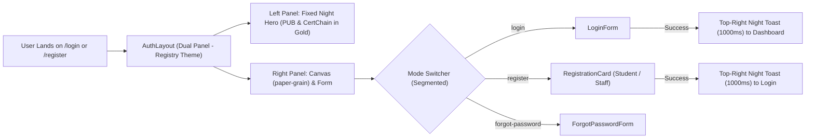

# PUB CertChain — Authentication UI/UX Design System Documentation

> **Version:** 2.1 (The Registry Theme Edition)  
> **Status:** Production-Ready  
> **Framework:** Next.js 15 (App Router), React 19, Tailwind CSS v4 (@theme), Lucide Icons  
> **Target Audience:** Developers, Designers, System Architects  

---

## 1. Overview & Design Philosophy

The authentication experience of **PUB CertChain** combines university academic identity with decentralized Web3 trust. It utilizes **"The Registry"** institutional archival theme from the `test` branch:

1. **Distraction-Free & Minimalist:** Eliminating marketing walls, heavy feature lists, or verbose text from the authentication flow.
2. **Fixed Dual-Panel Split:** A fixed brand identity showcase on the left (`bg-night`) paired with an independently scrollable form on the right (`bg-canvas` with `paper-grain`).
3. **Instantaneous & Non-Blocking Feedback:** Sleek top-right floating toasts (`bg-night`, `border-night-line`) that dismiss in **1000ms (1 second)** followed by immediate router redirection.
4. **Role-Adaptive Architecture:** Unified gateway accommodating Students (with student ID verification & Brevo OTP) and University Staff (with Controller review & MetaMask cryptographic wallet connection).



---

## 2. Visual Architecture & Color System (`test` Branch Theme)

| Token Name | Hex / CSS Value | Tailwind Utility / Usage | Purpose |
| :--- | :--- | :--- | :--- |
| **Night Base** | `#0E1622` | `bg-night` | Primary left hero background & toast background |
| **Night Grid** | `linear-gradient` | `.night-grid` | Subtle ledger rule-line pattern on dark surfaces |
| **Night Border** | `rgb(255 255 255 / 0.09)` | `border-night-line` | Subtle hairline dividers and borders on night surfaces |
| **Night Text** | `#E8E6E1` | `text-night-text` | Primary warm white typography for the left branding (`PUB`) |
| **Night Muted** | `#98A1AE` | `text-night-muted` | Secondary hints and close icons on night surfaces |
| **Seal Gold** | `#D4B06A` | `text-seal-bright` | High-contrast heritage accent for `CertChain` wordmark |
| **Registry Brand** | `#1D3A6B` | `bg-brand` / `text-brand` | Primary action buttons, focused input outlines, active indicators |
| **Brand Hover/Active** | `#162F59` / `#10244A` | `hover:bg-brand-hover` | Button interactive hover and pressed feedback states |
| **Warm Canvas** | `#F6F5F1` | `bg-canvas` / `.paper-grain` | Archival warm paper right-hand form canvas background |
| **Surface** | `#FFFFFF` | `bg-surface` | Form cards, dropdowns, and input containers |
| **Hairline Line** | `#E3DFD5` | `border-line` | Card borders, horizontal section rules |
| **Strong Line** | `#CDC7B9` | `border-line-strong` | Input field borders and emphasized dividers |
| **Deep Ink** | `#141B26` | `text-ink` | High-contrast primary text for form labels and headings |
| **Muted Ink** | `#6A6F78` | `text-muted` | Field hint descriptions and footer disclaimers |
| **Success Emerald** | `#146C43` | `text-success` / `bg-success/20` | Success toast status icon and border indicator |

---

## 3. Structural Layout: `AuthLayout.tsx`

The layout utilizes a desktop **Split-Screen** layout with independent scrolling mechanics:

### 3.1 Left Hero Panel (Desktop Branding)
- **Positioning & Dimensions:**
  - Width: `lg:w-[42%] xl:w-[38%]`
  - Height & Stickiness: `lg:sticky lg:top-0 lg:h-full lg:self-start overflow-hidden`
  - Container: `min-h-screen lg:h-screen lg:overflow-hidden`
  - Fixed in place: Prevents the left side from scrolling upwards when filling out long forms.
- **Background Grid Pattern:**
  - `bg-night text-night-text night-grid` with inline SVG patterned with blockchain nodes and interconnecting hash lines (`#D4B06A` seal gold and `#1D3A6B` brand navy at 20% opacity).
- **Top Action:**
  - Minimalist "Back to Main Site" pill (`<Link href="/">`) with `<ArrowLeft className="size-3.5" />` styled with `bg-night-2/80 hover:bg-night-3 border border-night-line text-night-muted hover:text-night-text`.
- **Center Hero Identity:**
  - **`P U B`**:
    - Classes: `text-8xl sm:text-9xl lg:text-[10rem] xl:text-[11rem] font-black tracking-[0.25em] lg:tracking-[0.3em] pl-[0.25em] lg:pl-[0.3em] leading-none text-night-text drop-shadow-md`
    - Uses matching left-padding (`pl-[0.3em]`) to counteract CSS letter-spacing offset and ensure true visual centering.
  - **`CertChain`**:
    - Classes: `mt-4 sm:mt-6 text-3xl sm:text-4xl lg:text-5xl xl:text-6xl font-extrabold tracking-[0.18em] lg:tracking-[0.22em] pl-[0.18em] lg:pl-[0.22em] text-seal-bright`
- **Zero Extraneous Text:**
  - No marketing walls, governance cards, or bullet points.

### 3.2 Right Form Area (`<main>`)
- **Scrolling Behavior:** `lg:overflow-y-auto lg:h-full` allowing form contents to scroll smoothly on desktop while the left branding remains anchored.
- **Canvas:** `bg-canvas paper-grain` with high-contrast `text-ink`.
- **Form Card Container:** Centered at `max-w-xl` with responsive padding (`p-4 sm:p-6 lg:p-10`).
- **Mobile Header:** Visible only on screens `< 1024px` (`lg:hidden`), featuring `Logo` with `tone="ink"` and an archival Home button.
- **Security Footer:** Institutional assurance notice stating `"Protected by PUB CertChain University Security Architecture"` with `OpenZeppelin RBAC · SHA-256 Ledger · Multi-Signature`.

---

## 4. Component Deep Dive

```
src/
└── components/
    └── auth/
        ├── AuthModule.tsx          # Centered Segmented switcher (Sign In / Create Account)
        ├── AuthLayout.tsx          # Split screen layout shell (Night & Canvas)
        ├── LoginForm.tsx           # Sign-in form + floating night toast
        ├── RegistrationCard.tsx    # Multi-role registration (Student / Staff)
        ├── ForgotPasswordForm.tsx  # Password recovery flow
        └── MetaMaskIssuerConnect.tsx# Web3 wallet signer for staff
```

### 4.1 Mode Orchestrator (`AuthModule.tsx`)
- Maintains the current mode state: `'login' | 'register' | 'forgot-password'`.
- Centered **Segmented Control Switcher** at the top (`max-w-xs mx-auto`):
  - "Sign In" vs "Create Account".
  - Built using `@/components/ui` (`Segmented`).

### 4.2 Sign-In Form (`LoginForm.tsx`)
- **Card Surface:** `bg-surface border border-line rounded-xl shadow-card`.
- **Action Button:**
  - Button text strictly remains **"Sign In"**.
  - During submission, shows `<Loader2 className="size-4 animate-spin" />` while preserving button dimensions and text.
- **Floating Toast Notification:**
  - Positioned at `top-5 right-5 sm:top-6 sm:right-6 z-50`.
  - Styled with `bg-night text-night-text border border-night-line shadow-overlay backdrop-blur-md`.
  - Auto-dismisses in exactly **1000ms (1 second)** followed immediately by `router.push(destination)`.
- **Session Cleanup:** Listens to `SESSION_EVENT_NAME` to reset loading state and clear passwords on sign-out.

### 4.3 Registration Interface (`RegistrationCard.tsx`)
- **Role Tabs:** Segmented switcher between Student (`GraduationCap`) and Staff (`Building2`).
- **Student Flow (2 Steps):**
  1. Record verification against pre-seeded admissions registry.
  2. 6-digit Brevo OTP verification.
- **Staff Flow:**
  - Official details and cryptographic MetaMask challenge signature (`MetaMaskIssuerConnect`).
  - Queued for Controller of Examinations approval.
- **Instant Toast Feedback:**
  - Both flows show top-right floating night toast with 1000ms duration.
  - Automatically switches back to Sign In.
  - **No in-card success cards or roadmaps.**
- **Buttons:** Static text with spinner icon only when submitting.

---

## 5. Summary of Differences from Dev Branch
- **Left Side:** Switched from `#10233F` and `#06B6D4` (Cyan) to `bg-night` (`#0E1622`) and `text-seal-bright` (`#D4B06A` Seal Gold) matching the `test` branch brand.
- **Right Side:** Switched from `#F5F7FB` to `bg-canvas` (`#F6F5F1`) with subtle `paper-grain` texture.
- **Buttons & Accents:** Switched from generic Tailwind `#2563EB` to registry `bg-brand` (`#1D3A6B`).
- **Cards & Inputs:** Integrated with `test` branch's `@/components/ui` design system primitives (`Card`, `Field`, `Input`, `Segmented`, `Alert`).
